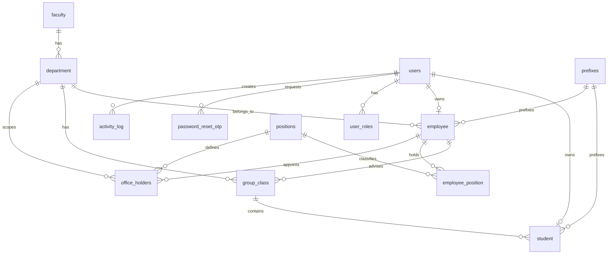
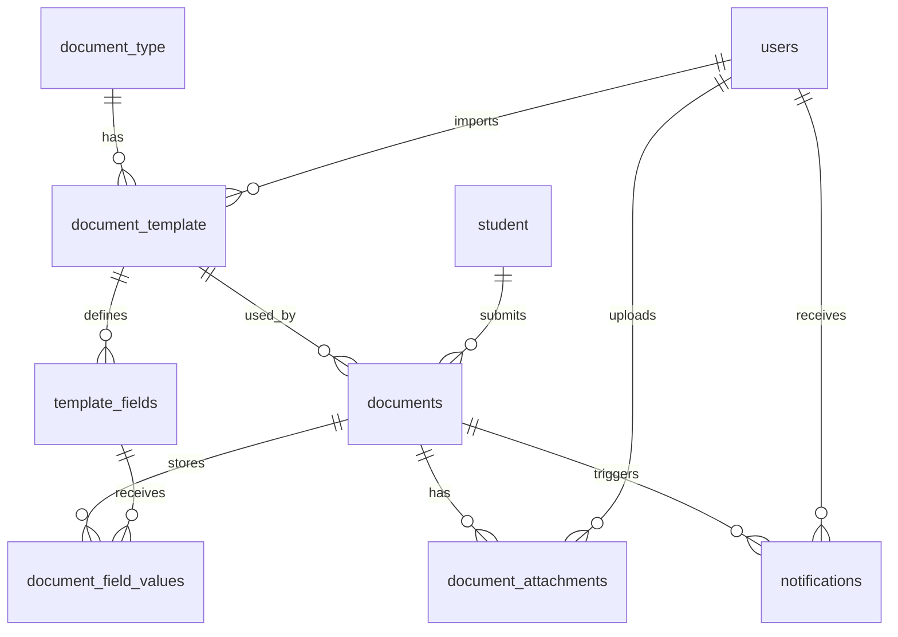
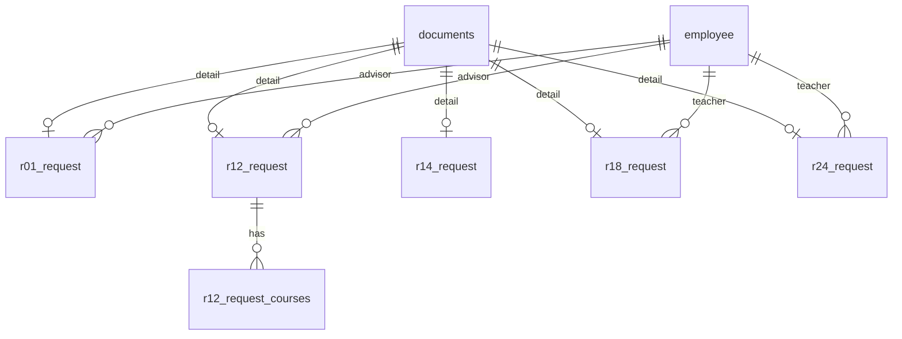
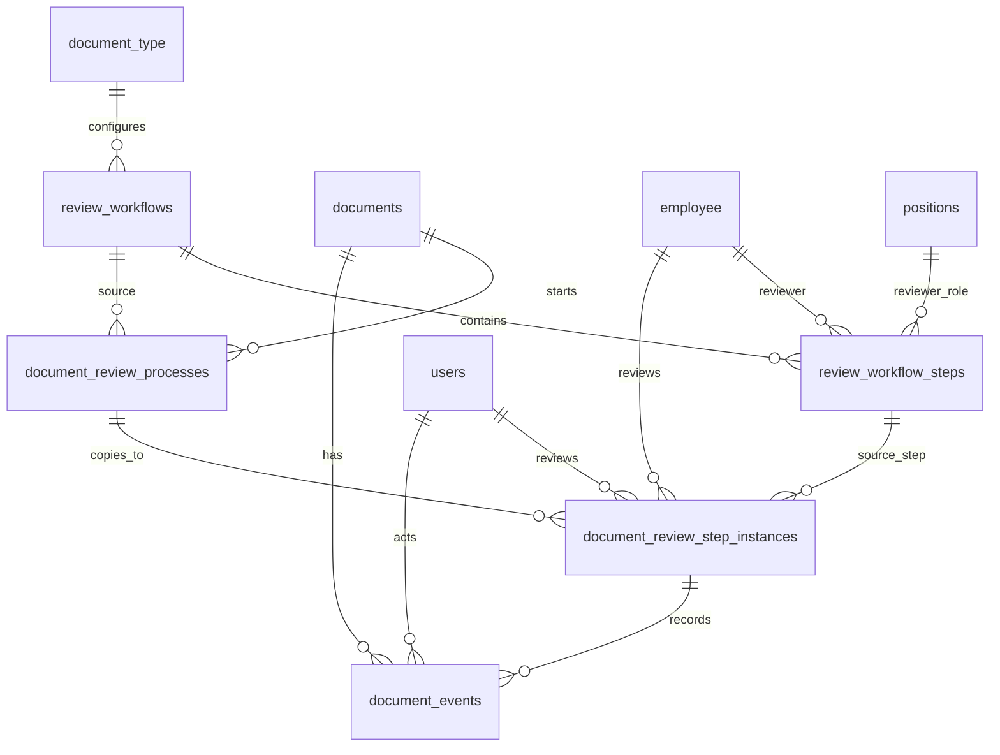
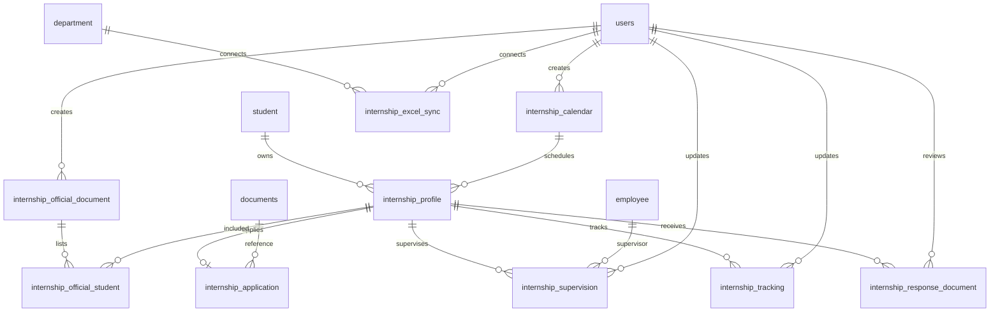

# ER Model ล่าสุด — ระบบจัดการเอกสารคำร้อง

อ้างอิงโครงสร้างฐานข้อมูล `online_request` ที่ตรวจสอบเมื่อ 2 กันยายน 2569

สัญลักษณ์: `PK` = Primary Key, `FK→ตาราง.คอลัมน์` = Foreign Key, `NN` = ห้ามว่าง

เอกสารถูกแยกเป็น 5 กลุ่ม เพื่อให้แต่ละแผนภาพอ่านง่ายและไม่เกิดเส้นทับกัน

---

## 1. บัญชีผู้ใช้ บุคลากร และโครงสร้างหน่วยงาน

### `users`

`user_id PK, username NN, email NN, password NN, first_login NN, status NN, active_session_token_hash, active_session_at, created_at NN`

### `user_roles`

`user_role_id PK, user_id FK→users.user_id NN, role NN`

### `password_reset_otp`

`otp_id PK, user_id FK→users.user_id NN, otp_code NN, expire_at NN, used NN, created_at NN`

### `activity_log`

`log_id PK, user_id FK→users.user_id, activity NN, detail, activity_time NN`

### `prefixes`

`prefix_id PK, prefix_name NN, prefix_short, status NN, created_at NN`

### `faculty`

`faculty_id PK, faculty_abbreviation NN, faculty_name NN`

### `department`

`department_id PK, faculty_id FK→faculty.faculty_id NN, department_abbreviation NN, department_name NN`

### `positions`

`position_id PK, position_name NN`

### `employee`

`employee_id PK, user_id FK→users.user_id NN, employee_code NN, prefix_id FK→prefixes.prefix_id, firstname NN, lastname NN, phone, department_id FK→department.department_id NN, employee_type NN, created_at NN`

### `employee_position`

`employee_position_id PK, employee_id FK→employee.employee_id NN, position_id FK→positions.position_id NN, is_primary NN`

### `group_class`

`group_id PK, department_id FK→department.department_id NN, group_name NN, advisor_employee_id FK→employee.employee_id`

### `student`

`student_id PK, user_id FK→users.user_id NN, student_number NN, prefix_id FK→prefixes.prefix_id, firstname NN, lastname NN, group_id FK→group_class.group_id`

### `office_holders`

`office_holder_id PK, position_id FK→positions.position_id NN, employee_id FK→employee.employee_id, holder_name, department_id FK→department.department_id NN, effective_from NN, effective_to, is_active NN, signature_title_line1, signature_title_line2, created_by FK→users.user_id, created_at NN, updated_at NN`

---

## 2. ประเภทเอกสาร แม่แบบ และเอกสารคำร้อง

### `document_type`

`document_type_id PK, document_code NN, document_name NN, form_file, description, status NN`

### `document_template`

`template_id PK, document_type_id FK→document_type.document_type_id NN, template_name NN, pdf_template, docx_template, original_file NN, preview_image, total_pages, file_type, status NN, imported_by FK→users.user_id, imported_at NN`

### `template_fields`

`field_id PK, template_id FK→document_template.template_id NN, field_name NN, field_label NN, field_type NN, page_no NN, pos_x NN, pos_y NN, width NN, height NN, font_size NN, required_field NN, default_value`

### `documents`

`document_id PK, student_id FK→student.student_id NN, template_id FK→document_template.template_id NN, document_status NN, created_at NN, updated_at NN, submitted_at`

### `document_field_values`

`value_id PK, document_id FK→documents.document_id NN, field_id FK→template_fields.field_id NN, field_value, updated_at NN`

### `document_attachments`

`attachment_id PK, document_id FK→documents.document_id NN, uploaded_by FK→users.user_id NN, original_name NN, stored_name NN, file_path NN, mime_type NN, file_size NN, uploaded_at NN`

### `notifications`

`notification_id PK, recipient_user_id FK→users.user_id NN, document_id FK→documents.document_id, notification_type NN, title NN, message NN, target_url, is_read NN, created_at NN, read_at`

---

## 3. รายละเอียดคำร้องแต่ละประเภท

> ทุกตารางในกลุ่มนี้เป็นรายละเอียดต่อจาก `documents` โดยใช้ `document_id` เป็น Foreign Key

### `r01_request`

`r01_id PK, document_id FK→documents.document_id NN, advisor_employee_id FK→employee.employee_id NN, subject, recipient, request_detail, phone, created_at NN`

### `r12_request`

`r12_id PK, document_id FK→documents.document_id NN, advisor_employee_id FK→employee.employee_id NN, course_code, course_name, old_group, new_group, reason, created_at NN`

### `r12_request_courses`

`r12_course_id PK, r12_id FK→r12_request.r12_id NN, item_no NN, semester, course_code, course_name, section, old_group, new_group`

### `r14_request`

`r14_id PK, document_id FK→documents.document_id NN, semester NN, academic_year NN, request_type NN, enrolled_credits NN, cumulative_gpa NN, created_at NN, updated_at NN`

### `r18_request`

`r18_id PK, document_id FK→documents.document_id NN, course_code, course_name, credits, semester, academic_year, teacher_employee_id FK→employee.employee_id, reason, created_at NN`

### `r24_request`

`r24_id PK, document_id FK→documents.document_id NN, leave_type, start_date, end_date, reason, course_code, course_name, teacher_employee_id FK→employee.employee_id, created_at NN`

---

## 4. ลำดับการพิจารณาเอกสาร

### `review_workflows`

`workflow_id PK, document_type_id FK→document_type.document_type_id NN, workflow_name NN, version_no NN, workflow_status NN, revision_return_policy NN, created_by FK→users.user_id, created_at NN, updated_at NN`

### `review_workflow_steps`

`workflow_step_id PK, workflow_id FK→review_workflows.workflow_id NN, step_order NN, role_code NN, step_name NN, reviewer_source NN, reviewer_employee_id FK→employee.employee_id, reviewer_position_id FK→positions.position_id, scope_type NN, is_required NN, created_at NN`

### `document_review_processes`

`process_id PK, document_id FK→documents.document_id NN, workflow_id FK→review_workflows.workflow_id NN, workflow_version_no NN, current_step_order, process_status NN, revision_count NN, started_at NN, completed_at, updated_at NN`

### `document_review_step_instances`

`document_step_id PK, process_id FK→document_review_processes.process_id NN, source_workflow_step_id FK→review_workflow_steps.workflow_step_id, step_order NN, role_code NN, step_name NN, reviewer_employee_id FK→employee.employee_id, reviewer_user_id FK→users.user_id, step_status NN, attempt_count NN, activated_at, reviewed_at, created_at NN, updated_at NN`

### `document_events`

`event_id PK, document_id FK→documents.document_id NN, document_step_id FK→document_review_step_instances.document_step_id, actor_user_id FK→users.user_id, event_type NN, detail, created_at NN`

---

## 5. กระบวนการสหกิจศึกษาและเอกสารทางการ

### `internship_calendar`

`calendar_id PK, academic_year NN, semester NN, start_date NN, end_date NN, status NN, created_by FK→users.user_id, created_at NN, updated_at NN`

### `internship_profile`

`internship_profile_id PK, student_id FK→student.student_id NN, request_status NN, request_reason NN, previous_profile_id FK→internship_profile.internship_profile_id, closed_reason, closed_at, calendar_id FK→internship_calendar.calendar_id, student_phone, year_level, recipient_name, company_name NN, company_address, subdistrict, district, province, postal_code, company_phone, company_fax, contact_prefix, contact_name, contact_position, contact_phone, job_position, job_description, capacity_note, recipient_position, recipient_department, company_number, company_moo, company_building, company_floor, company_road, company_alley, company_email, contact_department, contact_email, qualification_department NN, qualification_preparation NN, qualification_gpa NN, qualification_company NN, updated_at NN, created_at NN`

### `internship_application`

`internship_application_id PK, internship_profile_id FK→internship_profile.internship_profile_id NN, document_id FK→documents.document_id NN, request_date NN, contact_status NN, delivery_method NN, status NN, signed_file, submitted_at, created_at NN, updated_at NN`

### `internship_response_document`

`response_document_id PK, internship_profile_id FK→internship_profile.internship_profile_id NN, original_filename NN, stored_filename NN, review_status NN, review_note, reviewed_by FK→users.user_id, uploaded_at NN, reviewed_at, updated_at NN`

### `internship_tracking`

`internship_tracking_id PK, internship_profile_id FK→internship_profile.internship_profile_id NN, request_letter_status, response_status, application_status, send_letter_status, employment_status NN, notes, updated_by FK→users.user_id, created_at NN, updated_at NN`

### `internship_supervision`

`internship_supervision_id PK, internship_profile_id FK→internship_profile.internship_profile_id NN, supervisor_employee_id FK→employee.employee_id, visit1_date, visit1_time, visit1_mode, visit2_date, visit2_time, visit2_mode, supervisor_names, updated_by FK→users.user_id, lock_version NN, updated_at NN`

### `internship_official_document`

`official_document_id PK, document_type NN, company_name NN, document_number NN, document_date NN, recipient_name NN, reference_text, response_due_date, signatory_name NN, signatory_title_line1 NN, signatory_title_line2, created_by FK→users.user_id NN, created_at NN, updated_at NN`

### `internship_official_student`

`official_document_id PK/FK→internship_official_document.official_document_id NN, internship_profile_id PK/FK→internship_profile.internship_profile_id NN, sequence_no NN`

### `internship_excel_sync`

`sync_id PK, department_id FK→department.department_id NN, connected_by_user_id FK→users.user_id NN, refresh_token_encrypted NN, access_token_encrypted, access_token_expires_at, drive_id, item_id, workbook_name, worksheet_name, share_url, last_synced_at, last_sync_status, last_sync_message, created_at NN, updated_at NN`

---

## ตารางที่เกี่ยวข้องแบบสรุป

1. บัญชีผู้ใช้ทุกประเภทเริ่มที่ `users` แล้วเชื่อมเป็น `student` หรือ `employee` ตามบทบาทใน `user_roles`.
2. นักศึกษาอยู่ใน `group_class` ซึ่งอยู่ภายใต้ `department` และ `faculty`; อาจารย์ที่ปรึกษาเป็น `employee` ที่อ้างใน `group_class.advisor_employee_id`.
3. เอกสารเริ่มจาก `documents` แล้วเชื่อมกับชนิดเอกสารและแม่แบบ; ค่าแต่ละช่องเก็บใน `document_field_values`.
4. เอกสารแต่ละประเภทมีตารางรายละเอียดของตนเอง เช่น `r01_request`, `r12_request`, `r14_request`, `r18_request`, `r24_request`.
5. การพิจารณาเอกสารใช้ `review_workflows` และ `review_workflow_steps` เป็นการกำหนด แล้วบันทึกการทำงานจริงใน `document_review_processes`, `document_review_step_instances`, และ `document_events`.
6. สหกิจเริ่มที่ `internship_profile` ของนักศึกษา แล้วแตกเป็นการสมัคร หนังสือตอบรับ การส่งตัว การติดตาม และแผนนิเทศ.
