# ER Model ฉบับสมบูรณ์

ฐานข้อมูล: `online_request`  
จำนวนตาราง: 40 ตาราง  
ปรับปรุงจากฐานข้อมูลที่ใช้งานจริง ณ วันที่ 22 สิงหาคม 2569

> หมายเหตุ: ชื่อตารางใน ER ใช้ตัวพิมพ์เล็กทั้งหมดตามฐานข้อมูลจริง และแสดงเฉพาะคอลัมน์สำคัญต่อความสัมพันธ์/การทำงาน เพื่อให้อ่านได้ชัดเจนในรายงาน

```mermaid
erDiagram
    faculty {
        int faculty_id PK
        string faculty_abbreviation UK
        string faculty_name
    }
    department {
        int department_id PK
        int faculty_id FK
        string department_abbreviation UK
        string department_name
    }
    users {
        int user_id PK
        string username UK
        string email UK
        string password
        string status
    }
    user_roles {
        int user_role_id PK
        int user_id FK
        string role
    }
    prefixes {
        int prefix_id PK
        string prefix_name
        string prefix_short
        string status
    }
    positions {
        int position_id PK
        string position_name UK
    }
    employee {
        int employee_id PK
        int user_id FK
        string employee_code UK
        int prefix_id FK
        int department_id FK
        string firstname
        string lastname
        string employee_type
    }
    employee_position {
        int employee_position_id PK
        int employee_id FK
        int position_id FK
        boolean is_primary
    }
    office_holders {
        int office_holder_id PK
        int position_id FK
        int employee_id FK
        int department_id FK
        string holder_name
        date effective_from
        date effective_to
        boolean is_active
    }
    group_class {
        int group_id PK
        int department_id FK
        int advisor_employee_id FK
        string group_name
    }
    student {
        int student_id PK
        int user_id FK
        string student_number UK
        int prefix_id FK
        int group_id FK
        string firstname
        string lastname
    }

    document_type {
        int document_type_id PK
        string document_code UK
        string document_name
        string status
    }
    document_template {
        int template_id PK
        int document_type_id FK
        int imported_by FK
        string template_name
        string status
    }
    template_fields {
        int field_id PK
        int template_id FK
        string field_name
        string field_type
        int page_no
        decimal pos_x
        decimal pos_y
    }
    documents {
        int document_id PK
        int student_id FK
        int template_id FK
        string document_status
        datetime created_at
        datetime submitted_at
    }
    document_field_values {
        int value_id PK
        int document_id FK
        int field_id FK
        text field_value
    }
    document_attachments {
        int attachment_id PK
        int document_id FK
        int uploaded_by FK
        string original_name
        string file_path
        datetime uploaded_at
    }
    document_events {
        int event_id PK
        int document_id FK
        int document_step_id FK
        int actor_user_id FK
        string event_type
        text detail
        datetime created_at
    }
    notifications {
        int notification_id PK
        int recipient_user_id FK
        int document_id FK
        string notification_type
        string title
        boolean is_read
        datetime created_at
    }
    activity_log {
        int log_id PK
        int user_id FK
        string activity
        text detail
        datetime activity_time
    }
    password_reset_otp {
        int otp_id PK
        int user_id FK
        string otp_code
        datetime expire_at
        boolean used
    }

    review_workflows {
        int workflow_id PK
        int document_type_id FK
        int created_by FK
        string workflow_name
        int version_no
        string workflow_status
    }
    review_workflow_steps {
        int workflow_step_id PK
        int workflow_id FK
        int reviewer_employee_id FK
        int reviewer_position_id FK
        int step_order
        string role_code
        string reviewer_source
    }
    document_review_processes {
        int process_id PK
        int document_id FK
        int workflow_id FK
        int current_step_order
        string process_status
        int revision_count
    }
    document_review_step_instances {
        int document_step_id PK
        int process_id FK
        int source_workflow_step_id FK
        int reviewer_employee_id FK
        int reviewer_user_id FK
        int step_order
        string step_status
        datetime reviewed_at
    }

    r01_request {
        int r01_id PK
        int document_id FK
        int advisor_employee_id FK
        string subject
        text request_detail
    }
    r12_request {
        int r12_id PK
        int document_id FK
        int advisor_employee_id FK
        string course_code
        string old_group
        string new_group
    }
    r12_request_courses {
        int r12_course_id PK
        int r12_id FK
        string course_code
        string section
    }
    r14_request {
        int r14_id PK
        int document_id FK
        int semester
        int academic_year
        string request_type
        decimal cumulative_gpa
    }
    r18_request {
        int r18_id PK
        int document_id FK
        int teacher_employee_id FK
        string course_code
        string semester
    }
    r24_request {
        int r24_id PK
        int document_id FK
        int teacher_employee_id FK
        string leave_type
    }

    internship_calendar {
        int calendar_id PK
        int created_by FK
        int academic_year
        int semester
        date start_date
        date end_date
        string status
    }
    internship_profile {
        int internship_profile_id PK
        int student_id FK
        int calendar_id FK
        string company_name
        string company_address
        date start_date
        date end_date
    }
    internship_application {
        int internship_application_id PK
        int internship_profile_id FK
        int document_id FK
        string status
        string signed_file
        datetime submitted_at
    }
    internship_tracking {
        int internship_tracking_id PK
        int internship_profile_id FK
        int updated_by FK
        string request_letter_status
        string response_status
        string employment_status
    }
    internship_supervision {
        int internship_supervision_id PK
        int internship_profile_id FK
        int supervisor_employee_id FK
        int updated_by FK
        date visit1_date
        date visit2_date
    }
    internship_official_document {
        int official_document_id PK
        int created_by FK
        string document_type
        string company_name
        string document_number
        date document_date
    }
    internship_official_student {
        int official_document_id PK, FK
        int internship_profile_id PK, FK
        int sequence_no
    }
    internship_excel_sync {
        int sync_id PK
        int department_id FK
        int connected_by_user_id FK
        string workbook_name
        datetime last_synced_at
        string last_sync_status
    }

    faculty ||--o{ department : contains
    department ||--o{ employee : employs
    department ||--o{ group_class : contains
    department ||--o{ office_holders : assigns
    department ||--o| internship_excel_sync : connects
    prefixes ||--o{ employee : prefixes
    prefixes ||--o{ student : prefixes
    users ||--o{ user_roles : has
    users ||--o| employee : owns_account
    users ||--o| student : owns_account
    users ||--o{ notifications : receives
    users ||--o{ activity_log : performs
    users ||--o{ password_reset_otp : requests
    users ||--o{ document_attachments : uploads
    users ||--o{ document_events : acts
    users ||--o{ document_template : imports
    users ||--o{ review_workflows : creates
    users ||--o{ internship_calendar : creates
    users ||--o{ internship_tracking : updates
    users ||--o{ internship_supervision : updates
    users ||--o{ internship_official_document : creates
    users ||--o{ office_holders : registers
    users ||--o{ internship_excel_sync : connects
    positions ||--o{ employee_position : classifies
    positions ||--o{ office_holders : defines
    positions ||--o{ review_workflow_steps : assigns
    employee ||--o{ employee_position : holds
    employee ||--o{ office_holders : appointed
    employee ||--o{ group_class : advises
    employee ||--o{ r01_request : advises
    employee ||--o{ r12_request : advises
    employee ||--o{ r18_request : teaches
    employee ||--o{ r24_request : teaches
    employee ||--o{ review_workflow_steps : assigned_reviewer
    employee ||--o{ document_review_step_instances : reviews
    employee ||--o{ internship_supervision : supervises
    group_class ||--o{ student : groups

    document_type ||--o{ document_template : has
    document_type ||--o{ review_workflows : configures
    document_template ||--o{ template_fields : defines
    document_template ||--o{ documents : instantiates
    student ||--o{ documents : creates
    documents ||--o{ document_field_values : contains
    template_fields ||--o{ document_field_values : receives
    documents ||--o{ document_attachments : attaches
    documents ||--o{ document_events : records
    document_review_step_instances ||--o{ document_events : produces
    documents ||--o{ notifications : generates
    documents ||--o| document_review_processes : has_workflow
    review_workflows ||--o{ review_workflow_steps : contains
    review_workflows ||--o{ document_review_processes : used_by
    document_review_processes ||--o{ document_review_step_instances : creates
    review_workflow_steps ||--o{ document_review_step_instances : source_step

    documents ||--o| r01_request : represents
    documents ||--o| r12_request : represents
    r12_request ||--o{ r12_request_courses : contains
    documents ||--o| r14_request : represents
    documents ||--o| r18_request : represents
    documents ||--o| r24_request : represents
    student ||--o| internship_profile : has_profile
    internship_calendar ||--o{ internship_profile : schedules
    internship_profile ||--o| internship_application : submits
    documents ||--o| internship_application : represents
    internship_profile ||--o| internship_tracking : tracks
    internship_profile ||--o| internship_supervision : schedules
    internship_official_document ||--o{ internship_official_student : includes
    internship_profile ||--o{ internship_official_student : selected
```

## หลักการออกแบบข้อมูล

1. `documents` เป็นตารางศูนย์กลางของเอกสารทุกประเภท จึงไม่เก็บข้อมูลเอกสารซ้ำในหลายจุด
2. ตาราง `r01_request` ถึง `r24_request` และ `internship_application` เก็บเฉพาะข้อมูลเฉพาะของแต่ละแบบฟอร์ม โดยเชื่อมกลับมาที่ `documents` แบบหนึ่งต่อหนึ่ง
3. Workflow แยกเป็น 3 ระดับเพื่อรองรับการกำหนดลำดับจาก Admin และเก็บผลจริงของเอกสารแต่ละฉบับโดยไม่ทับข้อมูลตั้งค่าเดิม ได้แก่ `review_workflows` → `review_workflow_steps` → `document_review_step_instances`
4. `document_events` เป็นประวัติกลางของทุกการกระทำ เช่น ส่งเอกสาร อนุมัติ และส่งกลับแก้ไข ส่วน `notifications` เก็บรายการแจ้งเตือนของผู้รับแต่ละคน จึงไม่ถือเป็นข้อมูลซ้ำกัน
5. `office_holders` แยกจาก `employee` เพื่อให้ Admin เปลี่ยนผู้ดำรงตำแหน่งได้โดยไม่ต้องแก้ประวัติบุคลากร และเอกสารใหม่จะดึงข้อมูลผู้ดำรงตำแหน่งปัจจุบัน

## คำอธิบายการทำงานของแต่ละตาราง

| ตาราง | หน้าที่การทำงาน |
|---|---|
| `faculty` | เก็บข้อมูลคณะ เช่น รหัสคณะและชื่อคณะ เป็นข้อมูลอ้างอิงระดับสูงสุดของโครงสร้างองค์กร |
| `department` | เก็บข้อมูลสาขาวิชา/หน่วยงานภายใต้คณะ ใช้จำกัดขอบเขตข้อมูลของผู้ใช้ นักศึกษา และเจ้าหน้าที่แต่ละสาขา |
| `users` | บัญชีเข้าสู่ระบบกลางของผู้ใช้ทุกบทบาท เก็บชื่อผู้ใช้ อีเมล รหัสผ่าน สถานะ และข้อมูล Session ที่ใช้งานอยู่ เป็นแหล่งข้อมูลอีเมลเพียงจุดเดียวของระบบ |
| `user_roles` | กำหนดบทบาทของบัญชี เช่น `admin`, `student`, `staff`, `teacher` เพื่อควบคุมสิทธิ์เข้าถึงระบบ |
| `prefixes` | เก็บคำนำหน้าชื่อ เช่น นาย นางสาว ดร. รองศาสตราจารย์ เพื่อใช้ร่วมกับข้อมูลนักศึกษาและบุคลากร |
| `positions` | เก็บชื่อตำแหน่งงาน/ตำแหน่งผู้บริหาร เช่น คณบดี รองคณบดี หัวหน้าสาขา และอาจารย์ประสานงาน |
| `employee` | เก็บข้อมูลบุคลากร อาจารย์ และเจ้าหน้าที่ รวมถึงประเภทบุคลากร สาขา และบัญชีผู้ใช้ที่เชื่อมกัน โดยอีเมลเรียกจาก `users` |
| `employee_position` | ตารางเชื่อมบุคลากรกับตำแหน่ง รองรับบุคลากรหนึ่งคนมีได้หลายตำแหน่ง และกำหนดตำแหน่งหลักได้ |
| `office_holders` | เก็บผู้ดำรงตำแหน่งปัจจุบันและช่วงเวลาที่ดำรงตำแหน่ง เพื่อให้ Admin เปลี่ยนคณบดี/รองคณบดี/หัวหน้าสาขาได้โดยไม่กระทบข้อมูลเดิม |
| `group_class` | เก็บกลุ่มเรียนของนักศึกษา สังกัดสาขา และอาจารย์ที่ปรึกษาประจำกลุ่ม เป็นแหล่งข้อมูลอาจารย์ที่ปรึกษาเพียงจุดเดียว |
| `student` | เก็บข้อมูลนักศึกษา รหัสนักศึกษา กลุ่มเรียน และบัญชีผู้ใช้ที่เชื่อมกัน โดยอีเมลเรียกจาก `users` และอาจารย์ที่ปรึกษาเรียกจาก `group_class` |
| `document_type` | กำหนดประเภทเอกสารที่ระบบรองรับ เช่น R.01, R.14, R.24 และเอกสารสหกิจ |
| `document_template` | เก็บไฟล์ต้นแบบของเอกสารแต่ละประเภท เพื่อใช้สร้างตัวอย่างและ PDF ของเอกสาร |
| `template_fields` | กำหนดช่องกรอกและตำแหน่งบนไฟล์ต้นแบบ เช่น ชื่อ วันที่ หรือรหัสนักศึกษา ใช้สำหรับวางข้อความใน Preview/PDF |
| `documents` | ตารางศูนย์กลางของเอกสารแต่ละฉบับที่นักศึกษาสร้าง เก็บเจ้าของเอกสาร ต้นแบบที่ใช้ สถานะ และวันเวลาส่ง |
| `document_field_values` | เก็บค่าข้อมูลที่นักศึกษากรอกในช่องของต้นแบบแต่ละช่อง เชื่อมกับ `documents` และ `template_fields` |
| `document_attachments` | เก็บข้อมูลไฟล์แนบของเอกสาร เช่น ชื่อไฟล์ ตำแหน่งไฟล์ ผู้ที่อัปโหลด และวันเวลาที่อัปโหลด |
| `document_events` | บันทึกเหตุการณ์และประวัติการดำเนินงานของเอกสาร เช่น สร้าง ส่ง อนุมัติ หรือส่งกลับแก้ไข พร้อมผู้กระทำและหมายเหตุ |
| `notifications` | เก็บการแจ้งเตือนในระบบของผู้ใช้แต่ละคน เช่น มีเอกสารรอพิจารณา เอกสารถูกส่งกลับ หรือผ่านการพิจารณา |
| `activity_log` | เก็บประวัติการใช้งานทั่วไปของระบบเพื่อให้ Admin ตรวจสอบย้อนหลัง เช่น การเข้าสู่ระบบหรือการปรับข้อมูลสำคัญ |
| `password_reset_otp` | เก็บรหัส OTP และสถานะการใช้งานสำหรับกระบวนการรีเซ็ตรหัสผ่าน |
| `review_workflows` | เก็บชุดการตั้งค่าลำดับการพิจารณาของเอกสารแต่ละประเภท ซึ่ง Admin เป็นผู้กำหนดและสามารถเก็บหลายเวอร์ชันได้ |
| `review_workflow_steps` | เก็บรายละเอียดแต่ละขั้นของ Workflow เช่น ลำดับ ผู้พิจารณา แหล่งที่มาของผู้พิจารณา และการบังคับพิจารณา |
| `document_review_processes` | เก็บ Workflow ที่ถูกเริ่มใช้กับเอกสารแต่ละฉบับ บอกขั้นปัจจุบัน สถานะรวม และจำนวนครั้งที่ส่งกลับแก้ไข |
| `document_review_step_instances` | เก็บผู้พิจารณาและผลจริงในแต่ละขั้นของเอกสารแต่ละฉบับ จึงยังคงประวัติได้แม้ Admin เปลี่ยน Workflow ภายหลัง |
| `r01_request` | เก็บรายละเอียดเฉพาะของคำร้องทั่วไป R.01 เช่น เรื่อง ผู้รับ รายละเอียดคำร้อง และอาจารย์ที่ปรึกษา |
| `r12_request` | เก็บรายละเอียดเฉพาะของคำร้องแก้ไขกลุ่มวิชา R.12 เช่น รายวิชา กลุ่มเดิม กลุ่มใหม่ และเหตุผล |
| `r12_request_courses` | เก็บรายการรายวิชาเพิ่มเติมของคำร้อง R.12 กรณีคำร้องหนึ่งฉบับมีมากกว่าหนึ่งรายวิชา |
| `r14_request` | เก็บรายละเอียดคำร้อง R.14 เพื่อขอลงทะเบียนต่ำกว่า/เกินกว่าหน่วยกิตที่กำหนด เช่น ภาคการศึกษา หน่วยกิต และเกรดเฉลี่ยสะสม |
| `r18_request` | เก็บรายละเอียดคำร้อง R.18 ขอเปิดรายวิชาเรียน เช่น รายวิชา หน่วยกิต ภาคการศึกษา อาจารย์ผู้สอน และเหตุผล |
| `r24_request` | เก็บรายละเอียดคำร้อง R.24 ลาป่วย/ลากิจ เช่น ประเภทการลา ช่วงวันลา รายวิชา และอาจารย์ผู้สอน |
| `internship_calendar` | เก็บช่วงเวลาและสถานะปฏิทินฝึกประสบการณ์วิชาชีพของแต่ละปีการศึกษา/ภาคการศึกษา |
| `internship_profile` | เก็บข้อมูลการฝึกประสบการณ์ของนักศึกษา เช่น สถานประกอบการ ที่อยู่ ผู้ติดต่อ และตำแหน่งงาน โดยปีการศึกษา ภาคเรียน และระยะเวลาฝึกเรียกจาก `internship_calendar` |
| `internship_application` | เก็บข้อมูลใบคำร้องขอฝึกประสบการณ์ ณ สถานประกอบการ รวมถึงสถานะการพิจารณา ไฟล์ฉบับลงนาม และเวลาส่งให้เจ้าหน้าที่ |
| `internship_tracking` | เก็บสถานะติดตามงานสหกิจที่เจ้าหน้าที่กรอกเอง เช่น หนังสือสอบถาม หนังสือตอบรับ สมัครงาน หนังสือส่งตัว และการรับเข้าทำงาน |
| `internship_supervision` | เก็บแผนการนิเทศนักศึกษาครั้งที่ 1 และครั้งที่ 2 พร้อมอาจารย์ผู้นิเทศ วัน เวลา และรูปแบบการนิเทศ |
| `internship_official_document` | เก็บข้อมูลหนังสือราชการสหกิจที่เจ้าหน้าที่สร้าง เช่น หนังสือขอความอนุเคราะห์และหนังสือส่งตัว |
| `internship_official_student` | ตารางเชื่อมหนังสือราชการสหกิจกับนักศึกษาหลายคนในฉบับเดียว พร้อมลำดับรายชื่อสำหรับการสร้างเอกสาร |
| `internship_excel_sync` | เก็บการตั้งค่าการเชื่อมต่อและประวัติการซิงก์ข้อมูลสหกิจของแต่ละสาขากับ Microsoft Excel/ไฟล์งานภายนอก |

## สถานะข้อมูลหลักที่ใช้ในระบบ

| ส่วนงาน | สถานะสำคัญ |
|---|---|
| เอกสารทั่วไป (`documents`) | `draft`, `submitted`, `in_review`, `revision_requested`, `approved` |
| กระบวนการพิจารณา (`document_review_processes`) | `in_review`, `revision_requested`, `approved` |
| ขั้นพิจารณา (`document_review_step_instances`) | `pending`, `current`, `approved`, `revision_requested` |
| ใบคำร้องสหกิจ (`internship_application`) | ระหว่างจัดทำ, รอพิจารณา, รอลงนามฉบับจริง (`waiting_signature`), ส่งให้เจ้าหน้าที่แล้ว (`submitted`) |
